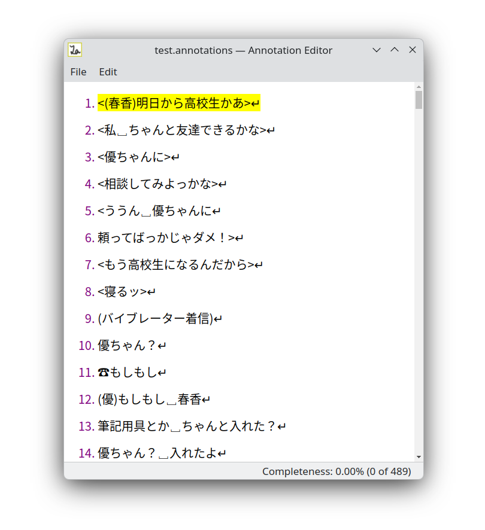
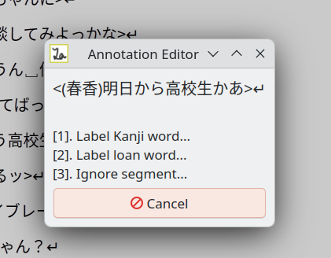
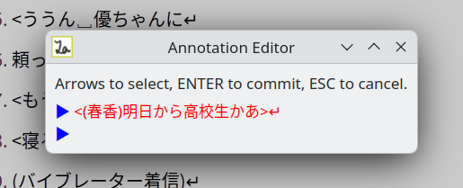
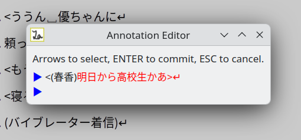
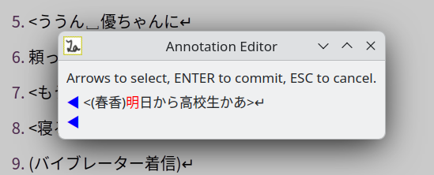
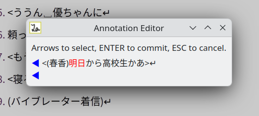
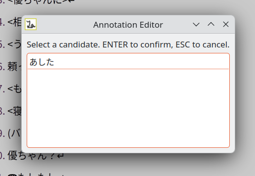
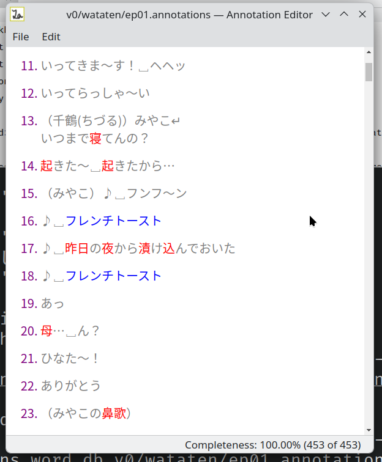
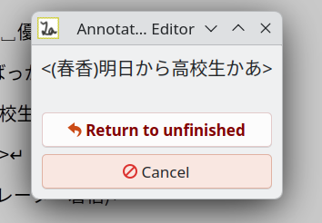
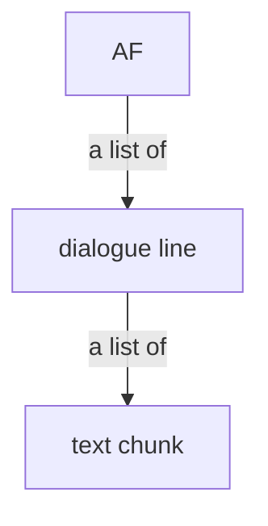

Annotation File is an intermediate representation used throughout ja_subify. In this documentation, "AF" is a short hand referring to it.

You can use the `import_srt` or `import_ass` program to create an Annotation File.

Annotation File can be edited by the `annotation_edit` program, or you can also edit it by hand or using scripts.

The purpose of AF is it can store furigana information (in this documentation, we will refer to "furigana" by the word "label" instead), and a few other metadatas useful for the editor program.

implemented in [annotation_file.py](../annotation_file.py).

## `annotation_edit`

The `annotation_edit` program is a graphical editor based on Qt and some Web stuff via WebEngineView (which is based on Chromium). Whole manual labeling process for an Annotation File is done using this app.

Despite being partially based on Web stuffs, this app supports dark mode (it follows system theme) and tries to avoid flickers at least on KDE desktop.

Currently, you must launch this program from command-line. This program takes a path to an Annotation File to edit, additionally, WordDB dictionaries to load. You should load at least one dictionary to be able to label stuffs.

An screenshot of the editor is provided below:



(You can use <kbd>Ctrl</kbd> and mouse wheel to adjust font size in the app.)

In this image, the yellow highlighted text represents current location of the virtual cursor.

This cursor moves around between dialogue lines (using W and S keys on your keyboard) and text chunks (using A and D keys).

Unfinished dialogue lines (those you haven't fully labeled or marked as ignore segment) will show in a normal black text color.

The editor allows you to move cursor only through lines or unfinished chunks, if a line is fully finished, tryign to move left / right will just bring you to the previous / next line.

The `annotation_edit` program can be used with mostly just keyboard controls.

Once you have selected an unfinished chunk using the cursor, you can hit ENTER key on your keyboard, or, don't use / move cursor at all but just simply click an unfinished chunk, will bring up a dialog menu for labeling. (The virtual cursor will still be moved automatically when you click or when you use the "Go to line..." feature and so on.)



Press number keys to select one of the annotation types. Select "Label Kanji word..." if you have some kanji that belong to a word. Select "Label loan word..." for English loan words inside the original Japanese text. Select "Ignore segments..." to mark a portion as ignored, that only contains Hiragana and Katakana or other characters that don't need labeling. (Marking as ignored for these is optional, but if you don't do it you won't be able to use "Go to next unfinished line" feature and the "Completeness" metre on status bar will show incorrect values.)



A dialog window similar to the one in Dictionary Viewer program is opened, allowing you to select portions that contains the word / chunk you intended.

Upon opening, it selects everything by default.

This window has two stages, initially, the blue triangle faces right, this means you can now tweak the beginning of your selection. After you hit ENTER, the triangles will face left, which means you should select the end of your selection. When you enter the second stage, your selection is automatically trimmed to a single character started by the beginning position you just selected. Your current selection is highlighted as red color.







Special characters like spaces or line breaks are made visible in this program.

In this dialog window, you can use a few shortcut keys:

| Key binding | What it does |
| --- | --- |
| <kbd>Ctrl</kbd> + <kbd>←</kbd> | Move to previous word |
| <kbd>Ctrl</kbd> + <kbd>→</kbd> | Move to next word |
| <kbd>Home</kbd> | Move left until reaching a line break |
| <kbd>End</kbd> | Move right until reaching a line break |
| <kbd>↑</kbd> | Move up by one row |
| <kbd>↓</kbd> | Move down by one row |

<kbd>Ctrl</kbd> + <kbd>←</kbd> / <kbd>→</kbd> moves based on boundaries of Kanji characters, Katakanas and other characters that ain't Kanji nor Katakana.

After you selected both end of your selection, the dialog will close if you're marking an ignore segment. It will open yet another window if you are labeling Kanji or loan word, if any candidate was found for labeling. If the word you are trying to label doesn't exist in any dictionary you loaded, the window closes and it shows an erorr message on the status bar. In that case, you should open the same dictionary in Dictionary Viewer program and add the missing word. You don't have to restart `annotation_edit`, as it supports automatic partially reloading for dictionaries. You can also keep both Dictionary Viewer and `annotation_edit` running at same time.

It's a trade off left to you to add word entries for every kanji or for every whole word in a dictionary, if you added dictionary entries to every kanji, the downside is every time you have to select from a potentially longer candidate list. Upsides are it needs less dictionary entries than the other option. If you added dictionary entries to every whole words (maybe compounds or inflections), the down side is more entries is needed in the dictionary while means bigger dictionary and more entries to add, but the up side is it becomes handy when you label things in the editor.

Samples in ja_subify repo uses the 2nd approach when managing dictionary entries. But you can invent your own policy when doing work locally. An Annotation File doesn't have any dependencies on external files, for example, it doesn't depend on the dictionaries you loaded in the edit when labeling. It's self-contained.



Text belong to a labeled loan word highlights as blue, kanji portions highlights as red, ignored portions highlights as gray.



To clear labels, right click a line or use the key binding <kbd>Alt</kbd> + <kbd>ENTER</kbd> which opens a dialog:



## the format of AF

> [!NOTE]
>
> You can skip this section unless you're a developer or interested in working with the AF file contents yourself.

AF is an object tree structure, its demonstrated by this diagram below:



the raw representation of AF (when stored on disk or when loaded by ja_subify) is based on the [JSON](https://en.wikipedia.org/wiki/JSON), the current version has the following content:

```json
{
  "lines": [],
  "version": 0
}
```

this is the root node of AF.

this corresponds to the `AnnotationFile` class in Python.

where `lines` is a list of the following content:

```json
{
  "end_time": "00:01:23,456",
  "fragments": [],
  "lineno": 123,
  "orig_line": "お外がポカポカして気持ち良さそうです",
  "start_time": "00:01:23,456"
}
```

this is a dialogue line in the AF.

this corresponds to the `DialogueLine` class in Python.

`start_time` and `end_time` have same meaning just like timestamps in an SRT subtitle.

`lineno`, `orig_line` are ignored when AF get read by ja_subify (but updated, more specifically, overwritten when AF is saved by ja_subify). They are provided for convenience which might make it easier to deal with the file using external tools.

`fragments` is a list of the following content:

```json
{
  "checked": false,
  "ignore": false,
  "inner": {},
  "type": 0,
  "unfinished": false
}
```

this is a text chunk in the dialogue line.

this corresponds to the `Annotation` class in Python.

`ignore`, `unfinished` fields are used by the editor program. `checked` field is reserved.

`type` field decides how contents in `inner` is interpreted.

| `type` value | meaning |
| --- | --- |
| 0 | `inner` contains a "plain annotation" object |
| 1 | `inner` contains a "kanji annotation" object |
| 2 | `inner` contains a "loan word annotation" object |

these values corresponds to the `AnnotationType` enumeration in Python.

### "plain annotation" object

this object contains the following content:

```json
{
  "text": "ポカポカして"
}
```

this corresponds to the `PlainAnnotation` class in Python.

`text` field contains plain text that is part of the dialogue line, but has no labels.

### "kanji annotation" object

this object contains the following content:

```json
{
  "fragments": []
}
```

this object contains a list of adjacent kanji chunks from the same Japanese word but can be split into smaller part where each part can be pronounced separately.

this corresponds to the `KanjiAnnotation` class in Python.

`fragments` is a list of the following content:

```json
{
  "base": "外",
  "reading": "そと"
}
```

this corresponds to the `KanjiCharacters` class in Python.

the `base` field is the one or more continuous kanjis from the original japanese dialgoue line, that has inseparatable pronunciation (for example "海苔" reads "のり" but they read together and each kanji doesnt have its own pronunciation and it's impossible to read separately. this is made specifically to support ["Jukujikun"](https://ja.wikipedia.org/wiki/%E7%86%9F%E5%AD%97%E8%A8%93)), `reading` is its pronunciation in its context.

### "loan word annotation" object

this object contains the following content:

```json
{
  "base": "ミラクル",
  "romanized": "miracle"
}
```

this corresponds to the `LoanAnnotation` class in Python.

`base` field is the original japanese text of this loan word, and `romanized` field is the english version which shall be displayed as a label on top when rendered by ja_subify.

## `import_srt`, `import_ass`

these program can read an existing subtitle file and convert it into an Annotation File.

it can also update timings in an existing Annotation File if the AF was created from the same subtitle file. The use case of this is you can retime the original subtitle using existing softwares, for example, in Aegisub, then you can use the `--retime` option to also update timings in the `.annotations` file that you have already imported previously, without losing your labels. The limitation is the program will check if your AF really appear to come from the same subtitle file. (i.e. If you have inserted, deleted, added or modified contents of dialogues in the original subtitle file, retiming will currently fail.)
